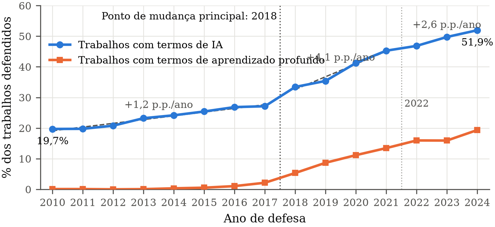
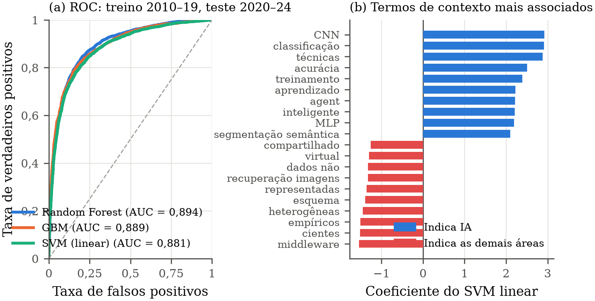

# Evolução Temática da Produção Científica em Computação no Brasil (2010-2024)

Este repositório contém a esteira de dados e as análises para o mapeamento longitudinal da produção científica na pós-graduação brasileira. O projeto aplica o processo de *Knowledge Discovery in Databases* (KDD), modelagem neural de tópicos (BERTopic) e algoritmos de machine learning nos microdados abertos da CAPES para rastrear a ascensão da Inteligência Artificial.

## Estrutura do Projeto
* `data/`: Base consolidada (`.csv.gz`). Contém as subpastas automáticas `resultados/` (para métricas e planilhas) e `figuras/` (para os gráficos exportados no padrão SBC).
* `scripts/`: Códigos Python para extração de dados brutos e o módulo do dicionário especialista (`lexico_ia.py`).
* `notebooks/`: Arquivos Jupyter contendo as 4 etapas metodológicas do estudo (NLP, Modelagem Não-Supervisionada, Estatística e Classificação Supervisionada).

## Pré-requisitos e Configuração do Ambiente
Para garantir a reprodutibilidade, recomenda-se a utilização de um ambiente virtual Python isolado.

1. Clone o repositório:
```bash
git clone https://github.com/diamondxorb/TAC-2026.2.git
cd TAC-2026.2
```

2. Crie e ative o ambiente virtual:
```bash
python3 -m venv venv
source venv/bin/activate
```

3. Instale as dependências externas para análise (versão CPU otimizada):
```bash
pip install -r requirements.txt
```

4. Baixe o modelo de linguagem em português do spaCy:
```bash
python -m spacy download pt_core_news_sm
```

## Execução das Análises
Acesse a pasta `notebooks/` iniciando o servidor com `jupyter notebook` e execute os arquivos sequencialmente:

1. **`01_pre_processamento_nlp.ipynb`**: Limpeza profunda e lematização dos resumos.
2. **`02_modelagem_topicos.ipynb`**: Clusterização semântica via BERTopic e benchmarking não-supervisionado de coerência (NPMI) e diversidade contra o modelo clássico LDA.
3. **`03_analise_estatistica_longitudinal.ipynb`**: Rotulagem léxica transversal de IA, detecção de mudança de regime estrutural (PELT e Teste de Chow), testes Qui-quadrado, Regressão Logística, Índice de Gini por instituição e exportação das Figuras 2, 3 e 4.
4. **`04_classificacao_supervisionada.ipynb`**: Treinamento de Random Forest, GBM e SVM Linear utilizando mascaramento dos termos-semente (*data leakage prevention*), validação de generalização temporal e extração do vocabulário de contexto (Figura 5).

## Principais Resultados
Nossa análise revelou uma mudança de regime estrutural na produção de IA no Brasil, com uma concentração institucional significativa. Além disso, os modelos supervisionados demonstraram que a IA possui uma assinatura vocabular de contexto própria, independente dos termos de busca óbvios.

<p align="center">
  
  
</p>

## Coleta e Limpeza de Dados (Opcional)
Se você deseja auditar ou recriar a base de dados do zero a partir do portal da CAPES, instale o pacote de extração manualmente:
```bash
pip install git+https://github.com/diamondxorb/catalogos-capes.git
```

Em seguida, execute os scripts na ordem:
1. **Download:** `python scripts/baixar_capes.py`
2. **Consolidação:** `python scripts/limpeza_planilhas.py`
3. **Atualização 2024:** `python scripts/atualizar_base_2024.py`

## Autoria
* **Júlia Paulo Amorim** (Universidade de Brasília)
* **Letícia Gonçalves Bomfim** (Universidade de Brasília)
